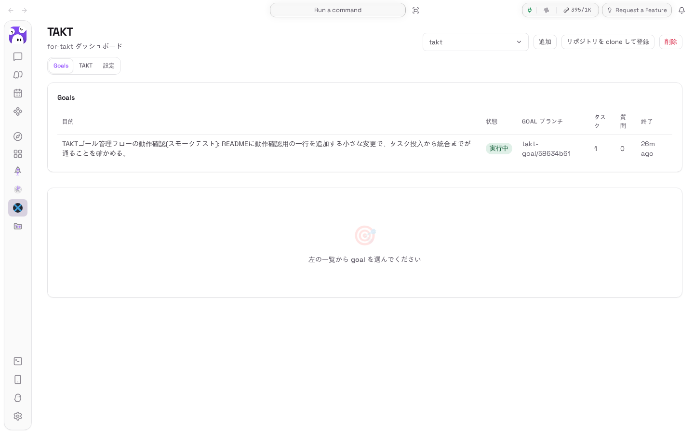
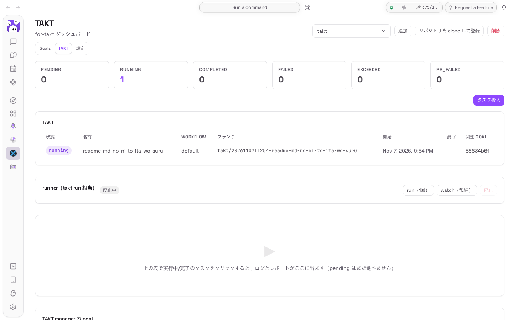
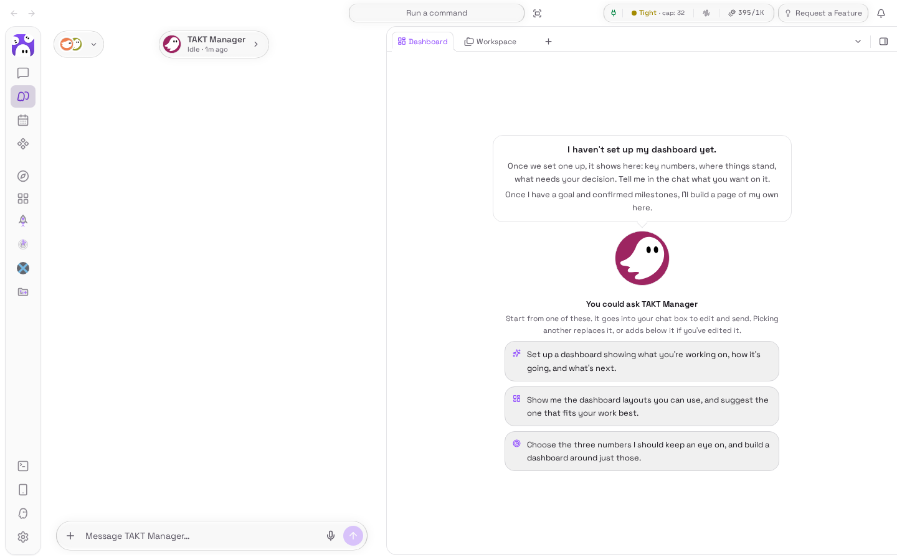

# for-takt — TAKT Bridge for Kiro Crew

A Kiro Crew external app that lets a Bot act as a TAKT "manager". It has three
parts:

- **stdio MCP server** (`for-takt:takt-bridge`, `mcp/server.py`) — the tool
  surface a Bot uses: goal records, `git merge-tree`-based integration
  checks/merges, and a relay to `takt-mcp` (`takt_list_tasks` / `takt_get_run` /
  `takt_enqueue_task` / `takt_tell_run`) plus read-only inspection of
  `.takt/goals/*/goal.json`.
- **in-gateway backend** (`backend/`) — App Kit `backend.hooks.routes` handlers
  under `/api/apps/for-takt/`, serving the dashboard: registered projects,
  app-owned goals, and read-only `.takt` data (tasks, run meta, paged session
  logs, reports, TAKT goal files).
- **dashboard page** (`ui/`) — a React page at `/apps/for-takt` (sidebar label
  **TAKT**) that polls the backend every few seconds. Read-heavy monitoring
  plus owner-gated controls: project add/remove/clone, goal pause/resume and
  question answering, TAKT task enqueue (`takt add` equivalent), runner
  start/stop (`takt run` / `takt watch` equivalent), and TAKT global config
  edits.

The app's own state lives under `data/` (goal records in `data/goals/`, the
project registry in `data/projects.json`). `.takt/` is **read-only** to this
app — nothing under it is ever written.

## Layout

```
app.json                      app manifest (v0.2: backend hook + ui + permissions)
agents/takt-manager.json      bot definition (read tools auto-approved)
skills/takt-goal-manager/     the manager playbook
takt_core/                    shared logic: goals store, git ops, takt-mcp
                              bridge, .takt readers, project registry
mcp/server.py                 JSON-RPC 2.0 loop + tool registry (stdlib only)
mcp/tests/                    unittest suite
backend/routes.py             register_routes() -> 23 routes
backend/handlers.py           route handlers (owner-gated writes)
backend/tests/                handler + .takt-reader tests
ui/                           Vite/React/TS source; dist/index.mjs is committed
assets/icon.png               app-store icon
```

## Requirements

- macOS or Linux, Python 3 (standard library only for `mcp/`; `takt_core/` and
  `backend/` additionally use `aiohttp` and `PyYAML` from the gateway venv)
- `git` on PATH
- `takt-mcp` (optional — TAKT tools error without it). Resolution order:
  `$TAKT_MCP_BIN` → `takt-mcp` on PATH → newest `~/.nvm/versions/node/*/bin/takt-mcp`.

## Trust (required for the backend)

`backend.hooks` run **inside the Gateway process** with full gateway
privileges (Kiro Crew CSE SEC-012). Installing/enabling is not enough — you must
grant execution trust for this app, or the routes module refuses to load
("Refusing to load third-party app 'for-takt' ...").

Grant it from the dashboard's Trusted Apps control (POST
`/api/security/trusted-apps/for-takt`), or add to `~/.kiro/crew/config.local.json`:

```json
{ "agent": { "apps_trusted": ["for-takt"], "apps_trusted_local": ["for-takt"] } }
```

Only do this if you trust this source tree — that is the whole point of the
setting.

## Screenshots

| | |
|---|---|
|  | Goals tab — app-owned goals with live status |
|  | TAKT tab — task table, runner controls, enqueue |
|  | The enrolled `takt-bot` member (Kiro Crew Bot) |

## Install / update

```
kirocrew app install ~/tmp/KiroCrew-app/for-takt
# after the trust grant above:
kirocrew app enable for-takt

# later changes:
kirocrew app update for-takt --source ~/tmp/KiroCrew-app/for-takt
```

## Dashboard usage

Open the **TAKT** page from the sidebar (`/apps/for-takt`).

- **Project selector** — add a git repository by absolute path (or a `file://`
  URL). The registry is app-owned; removing a project only unregisters it.
  `goal_create` via MCP also auto-registers its project.
- **Goals tab** — app-owned goals for the selected project: status, branch,
  task count, pending questions, updated time. Click a row for the detail:
  objective/scope/criteria, tasks with their linked TAKT task status (clicking
  it jumps to the run), pending questions (option buttons or free text), and
  the work log. **Pause**/**Resume** requires a reason and is owner-only.
- **TAKT tab** — status counts from `.takt/tasks.yaml`, the task table
  (failed/exceeded/pr_failed rows show the failing step + error; running and
  completed rows open the run detail, pending rows are marked not-yet-started),
  and a run view: meta (step/iteration/phase), step timeline, live session log
  that follows the newest `logs/*.jsonl` file, and reports rendered as
  markdown. TAKT goal files (`.takt/goals/*/goal.json`) are shown read-only in
  a collapsible section.
  - **タスク投入** — enqueues a task via `takt-mcp` (`takt add` equivalent).
  - **runner card** — starts/stops a detached `takt run` (once) or
    `takt watch` (persistent) for the project and shows the pid/mode plus the
    recent log tail. Because `takt run` executes *every* pending task, starting
    while pending tasks remain opens one confirmation listing them all.

Polling: projects/goals/tasks 5 s, selected run 3 s, run log 2 s while the run
is `running` — all paused when the page is inactive. Writes carry
`expectedRevision`; a 409 reloads and tells you to retry.

## Running it as an autonomous Bot

The `takt-manager` agent ships in `agents/` and is materialized as
`for-takt--takt-manager` on install. To run it unattended:

1. **Enroll it as a Bot (crew member).** The "New Bot" dialog only creates
   bots on the built-in worker template, so instead:
   - Create any bot (e.g. `takt-bot`), then in its editor switch **Built
     from** → `for-takt--takt-manager`, or
   - `POST /api/agents` with the default template, then
     `PUT /api/agents/takt-bot` with
     `{"kiro_agent": "for-takt--takt-manager", "expected_kiro_agent": "<current>"}`.
   - Set its **triggers** (e.g. "TAKT のゴール管理・タスク実行・統合チェック")
     so Kiro Crew may delegate matching work to it.
2. **Keep a `watch` runner resident** (TAKT tab → runner card →
   `watch（常駐）`, or the Bot's `takt_run` with `mode: "watch"`). Enqueued
   tasks then execute without anyone pressing run.
3. **Give it a wake schedule** so it patrols on its own:

   ```
   kirocrew cron add takt-supervise "<patrol prompt>" --every 1800 --agent takt-bot
   ```

   The skill's "Scheduled wake" section defines the patrol contract: report
   only what matters, restart a dead runner with an explicit `allow` list,
   and never start new work or resolve judgment calls unattended.
4. Channels work too: in a Slack/Discord/etc. conversation, `/agent
   takt-bot` binds that conversation to the Bot.

## Goal lifecycle

`draft → active → (paused) → awaiting_merge → completed`, with `aborted`
reachable from any non-terminal state. `draft→active` creates the goal branch
`takt-goal/<id8>`; `awaiting_merge→completed` requires the goal branch to be
already contained in `targetBranch` (the human performs that merge).

Write tools accept `expectedRevision` for optimistic locking.

## Backend routes

All under `/api/apps/for-takt/`; reads are session-scoped, POSTs are
owner-only (`ctx.require_owner`, fail-closed 403 when the gate is absent):

```
GET  /health              GET  /settings            POST /settings/takt-mcp
GET  /projects            POST /projects/add        POST /projects/remove
                          POST /projects/clone      POST /directories
GET  /goals  /goal        POST /goal/status         POST /goal/answer
GET  /takt/config                                 POST /takt/config
GET  /takt/tasks  /takt/run  /takt/run/log  /takt/run/report  /takt/goal-files
POST /takt/enqueue        GET  /takt/runner
                          POST /takt/runner/start  POST /takt/runner/stop
```

Notes on the write endpoints:

- `POST /projects/clone` — `git clone` an `https://`/`ssh://`/`git@` remote
  (or an absolute local path) into a chosen parent directory and register
  the result; sensitive destinations are refused and clone errors are
  redacted before they reach the client.
- `POST /settings/takt-mcp` — pin the `takt-mcp` binary (or send
  `{"path": null}` to return to auto-detection). Resolution order:
  app setting → `$TAKT_MCP_BIN` → `PATH` → newest nvm install.
- `GET /takt/config` — read `~/.takt/config.yaml` (global) plus the
  selected project's `.takt/config.yaml` (read-only).
- `POST /takt/config` — owner-only, writes only the whitelisted scalar
  keys `provider` / `model` / `language` to `~/.takt/config.yaml`, with a
  `.bak` backup and an mtime revision check (`revision` field from the
  GET response; stale revisions return 409). Project `.takt/` files stay
  strictly read-only.
- `POST /directories` — list subdirectories of a path (with `hasGit` /
  `hasTakt` hints) for the project picker; capped at 200 entries.
- `POST /takt/enqueue` — relays `takt_enqueue_task` to `takt-mcp` (no goal
  link; goal-tracked enqueue is the Bot's `takt_enqueue` MCP tool).
- `GET /takt/runner` + `POST /takt/runner/start|stop` — manage the detached
  `takt` runner whose record lives under `data/runner/`. `start` accepts
  `mode` (`once`|`watch`) and refuses (409) when pending tasks exist that are
  not in `allow` (or `allowAll: true`), since `takt run` picks up the whole
  pending queue.

## Test

```
<KiroCrew>/.venv/bin/python -m unittest discover -s mcp/tests
<KiroCrew>/.venv/bin/python -m unittest discover -s backend/tests
```

(`<KiroCrew>` = local checkout of the Kiro Crew repository.)

(Any Python ≥3.9 works for `mcp/tests`; `backend/tests` needs `aiohttp`/`yaml`,
which the gateway venv provides.)

```
cd ui && npm install --legacy-peer-deps && npm run build
```

`--legacy-peer-deps` is needed because `@kirocrew/app-sdk` is host-provided and
not on the npm registry.

## Deviations from the designs

- `goal_complete` takes `expectedRevision` too (v0.1 DESIGN §4 says all write
  tools accept it).
- `integration_apply` takes an optional `taskName` naming the goal's task
  record to mark integrated. takt-mcp's enqueue result carries no branch
  (TAKT names it `takt/<timestamp>-<task>` only when the task runs), so
  without `taskName` the task is matched by recorded branch, then task name,
  then that naming convention when exactly one open task fits. An unknown
  `taskName` is refused before any ref moves.
- `h_takt_enqueue` re-checks `status == "active"` and project equality inside
  the `update_goal` mutator; on failure the TAKT task stays enqueued but the
  goal records nothing and the response says so (`recorded: false` +
  `recordError`).
- `takt_run_log` returns offset-paged **parsed NDJSON records** (plus
  `raw`/`truncated` flags) rather than raw text, and a `reset: true` flag when
  the requested offset is past the current file size.
- The UI exposes no integration-apply, goal create/complete, cron/IRQ, SSE,
  or per-task TAKT requeue/stop controls — those stay MCP-only by design.
  Beyond the original designs it does enqueue TAKT tasks (`takt add`
  equivalent, not linked to a goal) and start/stop the project runner
  (`takt run` / `takt watch`), so TAKT can be driven without a terminal.
- Beyond DESIGN-ui: the settings tab (takt-mcp pin, `~/.takt/config.yaml`
  whitelist edit), `POST /directories`, and `POST /projects/clone` were
  added after reviewing the aidlc reference app; project `.takt/` files
  remain read-only.

See DESIGN.md (v0.1) and DESIGN-ui.md (v0.2) for the full specifications.
